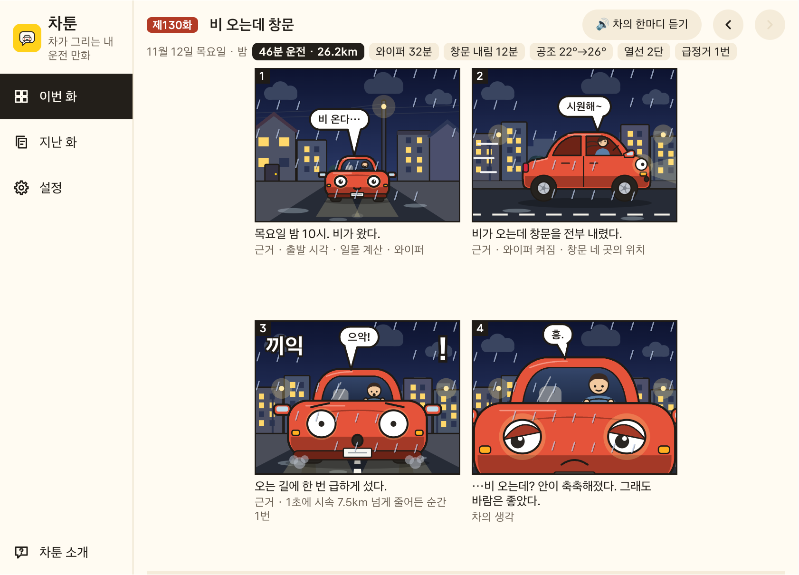
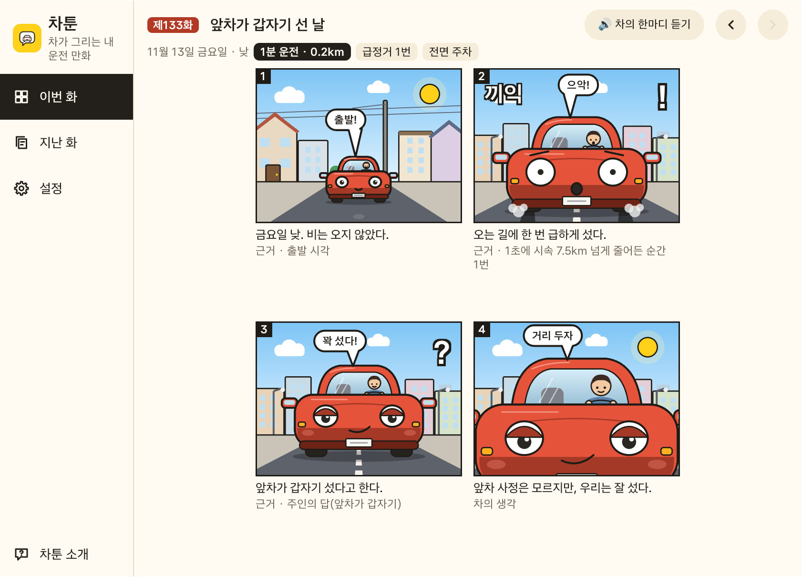
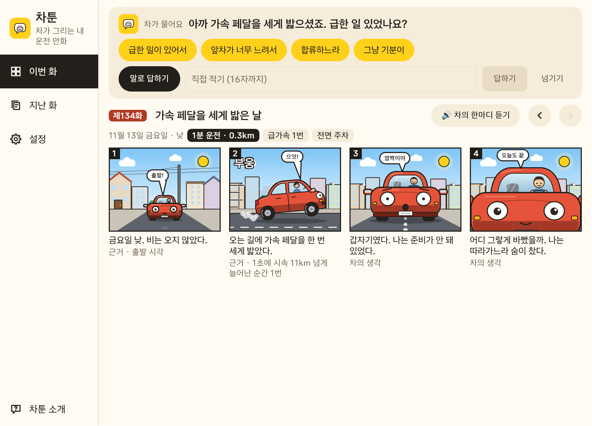

# 차툰

**하루 중 별것 아닌 이동으로 여겨져 금세 잊히는 운전 시간, 차툰은 그사이 차가 본 순간을 네 컷 만화로 남깁니다.**

창문을 내린 때, 비가 와 와이퍼를 켠 때, 급하게 선 때. 주차하면 그 주행이 차의 눈으로 그린 네 컷 한 화가 되고, 화가 쌓이면 지나간 운전을 회차 넘기듯 돌아볼 수 있습니다. 현대자동차그룹 차량용 앱 개발 공모전(Code your App into Pleos App Market) 출품작이고, Pleos Connect에서 돕니다.

<p align="center"></p>

> **처음 보는 분께**
> - 앱 이름·한 줄 소개·실행 방법·테스트 환경·APK 위치: [제출용 앱 정보](#제출용-앱-정보)
> - 왜 만들었고 무엇을 하는지: [기획서](contests/hmg-vehicle-app/기획서.md)
> - 실제로 도는 모습: [시연 영상](docs/demo/차툰_시연영상.mp4)(3분 25초, 소리 없음)
> - 확인한 근거(화면 캡처·로그·측정값): [실험 기록](research/experiments/README.md)

## 왜 만들었나

한두 시간을 운전하고 내리면 그 시간에 무엇을 했는지 잘 떠오르지 않습니다. 운전하는 동안은 다른 일을 할 수 없으니 그 시간은 "그냥 이동한 시간"이 되어 하루에서 빠져나갑니다. 그런데 차는 그 시간을 다 봤습니다. 비가 와서 와이퍼를 켰고, 답답해서 창문을 내렸고, 한 번 급하게 섰다는 것을 차량 신호로 압니다. 차툰은 그 일들을 점수나 그래프가 아니라, 차가 이야기하는 만화로 돌려줍니다.

## 무엇이 만화가 되나

모두 차량 신호에서 나옵니다. 위치, 경로, 카메라는 쓰지 않습니다.

| 남는 장면 | 차가 아는 방법 | 컷 |
| --- | --- | --- |
| 비가 와서 와이퍼를 켰다 | 와이퍼 | 빗줄기와 물웅덩이, "비 온다…" |
| 창문을 내리고 달렸다 | 창문 위치 | 옆모습에 바람, "시원해~" |
| 추워서 달리다 히터 온도를 올렸다, 더워서 에어컨 온도를 내렸다 | 출발 때와 주차 전 공조 설정 온도 | 온도계에 "22°→26°"와 열기나 눈꽃 |
| 에어컨이나 히터를 세게 틀었다 | 공조 설정 온도·풍량 | 눈꽃이나 열기 |
| 엉덩이 열선(엉뜨)이나 통풍시트를 켰다 | 운전석 시트 열선·통풍 단계 | 시트에서 올라오는 열기나 파란 바람, "따끈따끈" |
| 급하게 섰다 / 가속 페달을 세게 밟았다 | 차량 속도의 1초 변화(운전자가 켤 때만) | 놀란 얼굴과 "끼익" / 앞이 들린 옆모습과 "부웅" |
| 주차를 몇 번 만에, 어느 방향으로 넣었다 | 주차 직전 기어 기록 | 위에서 본 주차장과 R·D 화살표 |
| 별일 없던 날의 작은 고비 | 지난 기록(10번째 주행, 며칠 만의 비, 연속 한 번에 주차 등) | 「나흘 만의 비」, 「세 번 연속 한 번에」 |

화마다 그 주행의 시간과 거리(「46분 운전 · 26.2km」)와 차가 읽은 신호(와이퍼 12분, 공조 22°→26° 같은 칩)가 붙고, 지난 화 맨 위에는 「11월에 운전한 15시간 18분, 만화 18화로 남았어요」처럼 이번 달 운전 시간이 보입니다.

세운 뒤에는 차가 묻습니다. "어디 가시는 길이었나요?", "아까 급하게 서셨죠. 괜찮으세요?" 보기를 누르거나, 적거나, 말로 답하면(SpeechToText) 그 말에서 상황을 읽어 그 화를 다시 그립니다. 차는 그 화의 한마디를 소리 내어 읽고(TextToSpeech), 켜 둔 사람에게는 실내 조명이 장면 색으로 바뀝니다(Vehicle SDK).

<p align="center">


</p>

이야기(콘티)는 차가 짭니다. 차량 신호에서 그날의 순간을 고르고, 네 컷을 나누고, 대사와 근거를 붙입니다(대사 틀은 사람이 씀). 그림은 지금은 앱 코드(Compose Canvas)가 차 안에서 바로 그리고, 다음 단계에서는 같은 콘티를 생성형 AI가 내 차와 그날의 날씨·계절을 담아 그립니다(주인이 켤 때만, 기획서 6번). 만화의 재료는 차량 신호 요약뿐이고 위치·경로·카메라 영상·목소리 원본은 쓰지 않습니다.

## 제출용 앱 정보

| 항목 | 내용 |
| --- | --- |
| 앱 이름 및 한 줄 소개 | **차툰** — 하루 중 별것 아닌 이동으로 여겨져 금세 잊히는 운전 시간에 차가 본 순간(비가 와 와이퍼를 켠 때, 창문을 내린 때, 급하게 선 때)을, 주차할 때마다 네 컷 만화로 그려 다시 볼 수 있게 하는 Pleos 차량용 앱입니다. |
| 실행 방법 | ① 설치: `adb install apk/HumanFirst_차툰_release.apk` ② 실행: `adb shell am start --user 10 -n kr.chatoon.app/.ui.MainActivity` ③ 첫 화면(소개)에서 **시작하기** → 동의 화면에서 **동의하고 시작하기**(알림 허용 창이 뜨면 허용) ④ 주행 한 번: 가상 콘솔에서 기어를 D로 바꾸고, 와이퍼·창문을 켜 보고, R·D를 오간 뒤 P로 두면(또는 저장소 루트에서 `python3 tools/vc.py scenario parking`) **이번 화**에 그 주행의 네 컷이 나오고, 평소와 다른 주행이었으면 차가 묻습니다. 앱 화면이 「주행 중에는 사용할 수 없습니다」로 가려져 있으면 콘솔 기어가 D인 것이니 P로 바꿉니다(`python3 tools/vc.py set gear Park`). R 기어를 쓴 뒤 Pleos 후방 카메라 화면이 앞에 남아 있으면 ②의 실행 명령으로 차툰을 다시 엽니다. 소스 빌드는 [app/README.md](app/README.md) |
| 테스트 환경 및 필요한 설정 | Android Studio + **Pleos Connect v2.1.0 에뮬레이터**(Android API 34, `system-images;android-34;pleos_car_emulator;arm64-v8a`, Cold boot, RAM 4GB). **화면 규격**: 가로 2560×1440px, 160dpi(1dp = 1px). 앱은 그 안의 창에 뜨며 창 크기는 1682×1210px(기본)입니다. 주행 재현은 Virtual Console(`adb forward tcp:8088 tcp:8088`)로 기어·와이퍼·속도·창문·공조·열선을 바꿉니다(`python3 tools/vc.py set …`, `scenario …`). 급하게 선 순간과 세게 밟은 순간은 앱에서 차량 속도 권한을 켜야 셉니다. 달리는 동안(D단)에는 Pleos가 앱 화면을 가리므로 만화는 P단에서 봅니다. 실내 조명 연출은 설정에서 켜고, 가상 콘솔의 실내 조명 값으로 확인합니다. 빌드: Gradle 9.8.2, AGP 9.5.0, minSdk 28, Pleos SDK `Vehicle 2.3.2`·`TextToSpeech 3.3.1`·`SpeechToText 3.3.1`(공개 Maven, 계정 불필요). 자세한 설치는 [Pleos 플랫폼 정리](docs/pleos-platform.md) |
| APK 위치 또는 Release 링크 | [`apk/`](apk/) 폴더의 `HumanFirst_차툰_release.apk` (release, 서명됨) |

## 검증 요약

| 항목 | 내용 |
| --- | --- |
| 자동 테스트 | 단위 테스트 188개(제출 APK의 앱 코드 기준 모두 통과, CI가 커밋마다 실행). 만화를 쓰는 규칙은 웹 시안이 만든 900가지 경우와 글자 하나까지 대조합니다 |
| 차량 신호 | 가상 콘솔로 창문 75초·공조 17도·풍량 최대·열선 2단을 주고 달리니 주행 기록에 같은 값이 남고 이번 화에 창문·열선 컷이 나옴(debug, [기록](research/experiments/2026-11-13-cabin-signals/README.md)) |
| 소재 반복 | 출퇴근만 하는 가상 운전자 4주 40화에서 「별일 없는 날」 100% → 55%(평범한 날에도 지난 기록의 고비로 쓰게 고친 뒤, `CartoonRepetitionTest`) |
| release(R8) 실주행 | 처음 소개 → 동의 → 비·창문·히터 22→26°·열선·급정거·후면 주차를 한 번에 넣은 주행 → 「비 오는데 창문」과 차가 본 것 칩 → 급정거 질문 → 보기 답으로 다시 그림(답은 근거 줄에만)까지 확인, 새 서명 키(CN=Chatoon)([기록](research/experiments/2026-11-13-chatoon-release-4/README.md)). 제출한 APK 파일 그대로도 같은 흐름을 다시 확인([기록](research/experiments/2026-11-13-chatoon-submitted-apk/README.md)) |
| 주행 중 성능 | release 빌드로 앱을 띄우고 60초 뒤부터 60초 동안 신호를 140번 바꾸며 측정: CPU 코어 1개 기준 3.99%·3.33%, 메모리(PSS) 최대 41.5MB(Pleos 기준 5% 미만·400MB 이하, [기록](research/experiments/2026-11-13-chatoon-release-4/README.md)) |
| 확인하지 못한 것 | Pleos 탑재 실차, 실제 마이크로 받아쓰기, 차의 목소리를 귀로 듣기, 공조 전원·에어컨 켜짐 값(신호는 있으나 지금 빌드는 아직 쓰지 않고 설정 온도로 판단) |

## 저장소 구성

```text
├── README.md
├── app/                               # 안드로이드 앱(Pleos Connect). 빌드·구조는 app/README.md
├── apk/                               # 제출용 release APK(HumanFirst_차툰_release.apk)
├── contests/hmg-vehicle-app/
│   ├── 기획서.md                       # 접수양식 02장 1~8번 원문
│   ├── assets/screens/                 # 기획서와 README의 앱 화면(에뮬레이터 실제 화면)
│   └── submissions/                    # 접수양식 02장을 채운 DOCX
├── docs/
│   ├── demo/차툰_시연영상.mp4             # 시연 영상(3분 25초)
│   ├── cartoon/카툰_상세안.html          # 처음 설계한 상세안과 웹 시안(규칙 대조의 기준)
│   ├── pleos-platform.md               # Pleos 공식 문서 요약
│   ├── sdk-reference.md                # SDK 함수 기능 사전
│   └── dev-environment.md              # Pleos Connect SDK·개발 환경
├── research/
│   ├── experiments/                    # 에뮬레이터 실험 기록(캡처·로그·스크립트)
│   └── sources/                        # 기획서 출처의 원문 인용
├── tools/
│   ├── vc.py                           # 가상 콘솔 시연·검증 도구(주행 시나리오, 신호 바꾸기, CPU·메모리 측정)
│   ├── demo_video.py                   # 시연 영상 자동 녹화
│   ├── cartoon_golden.mjs              # 웹 시안으로 대조용 경우 만들기
│   └── fill_proposal_docx.py           # 기획서 → 공식 접수양식 02장 DOCX
└── .github/workflows/android-build.yml # app/ 변경 시 테스트·lint·APK 빌드 확인
```

## 오픈소스 라이선스와 출처

공모전 이용약관 제7조 7항에 따라 release APK에 들어가는 외부 구성요소를 밝힙니다. 라이선스는 각 라이브러리의 Maven POM 파일에서 확인했습니다.

| 구성요소 | 버전 | 라이선스 | 출처 |
| --- | --- | --- | --- |
| Pleos Playground SDK (`ai.pleos.playground:Vehicle`, `TextToSpeech`, `SpeechToText`) | 2.3.2 / 3.3.1 / 3.3.1 | POM에 라이선스 표기 없음. Pleos Playground 제공 조건을 따름 | https://nexus-playground.pleos.ai |
| Jetpack Compose, AndroidX (Activity, Lifecycle 등) | Compose BOM 2026.09.00 | Apache License 2.0 | https://developer.android.com/jetpack/androidx |
| Kotlin 표준 라이브러리, kotlinx.coroutines | 2.2.10 / 1.11.0 | Apache License 2.0 | https://github.com/JetBrains/kotlin, https://github.com/Kotlin/kotlinx.coroutines |
| Pleos SDK가 함께 가져오는 라이브러리: Gson, kotlinx.serialization, Dagger/Hilt, javax.inject, JSR-305, JetBrains annotations, JSpecify, Guava listenablefuture | 각 SDK의 POM에 적힌 버전 | Apache License 2.0 | 각 Maven POM |

- 글꼴: 차량의 Pleos 시스템 글꼴(Asta Sans)을 기기에서 읽어 쓰며 앱에 넣어 배포하지 않습니다. 없는 기기에서는 안드로이드 기본 글꼴을 씁니다.
- 그림·아이콘·음원: 만화의 그림은 앱 코드(Compose Canvas)가 그 자리에서 그리고, 앱 아이콘도 팀이 그렸습니다. 그림 파일·외부 그림·아이콘 세트·음원은 쓰지 않습니다. 생성형 AI로 만든 그림도 없습니다.
