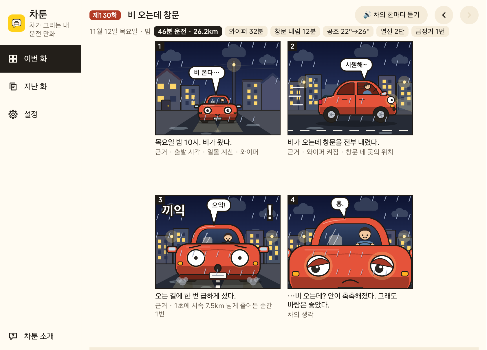
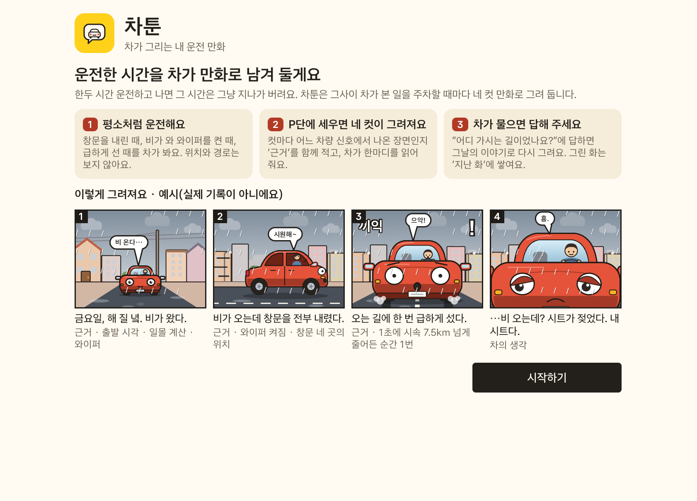
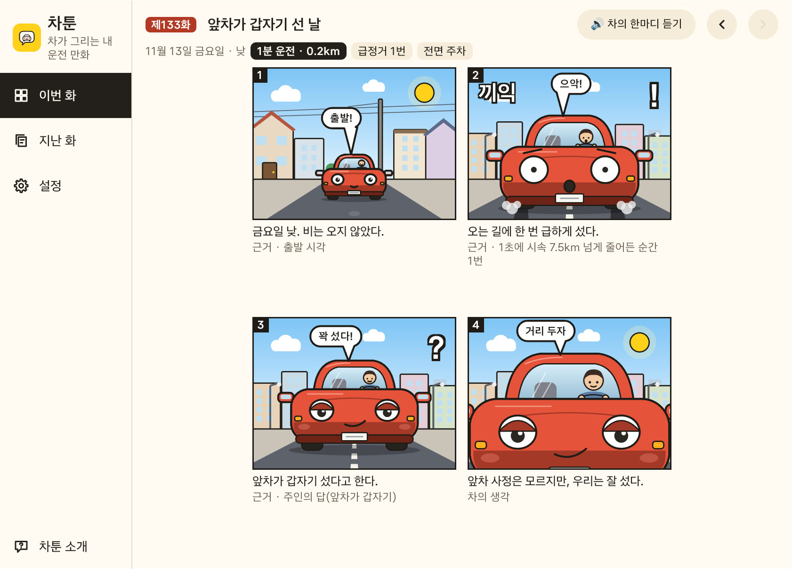
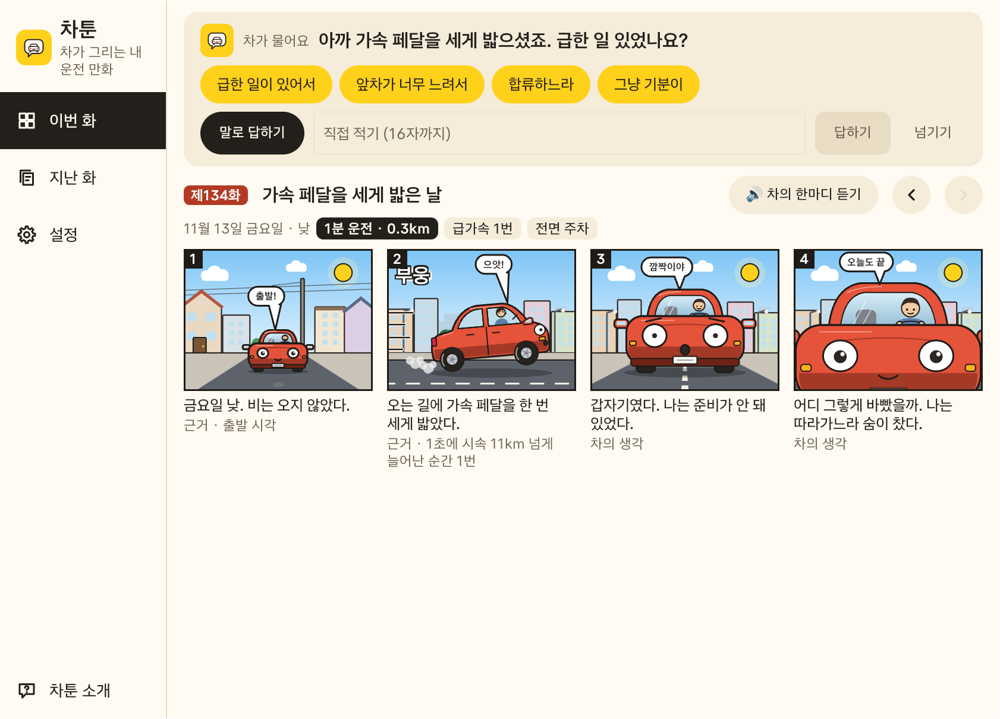

# 차툰 기획서 (접수양식 02장)

<!--
작성 안내(화면에는 보이지 않음): 공식 접수양식 02장 순서 그대로이고, `python3 tools/fill_proposal_docx.py`로 DOCX 02장에 옮긴다.
이 장에는 성명·연락처·이메일·소속을 적지 않는다. 첨부 링크에도 실명·계정정보가 드러나지 않게 한다.
기능 설명은 저장소의 코드·실험 기록·에뮬레이터 확인 결과에 있는 것만 쓴다("근거: `경로`" 줄은 DOCX로 옮길 때 빠진다). 통계는 1차 출처를 붙이고, 확인하지 못한 것과 가정은 ※번호로 표시해 6번 끝 「검증 현황과 한계」 표에 모은다.
출처 번호를 바꾸면 research/sources/차툰_기획서_출처_원문.md도 같이 바꾼다.
-->

앱명 / 프로젝트명: **차툰**

## 1. 앱 한 줄 소개

차툰은 하루 중 별것 아닌 이동으로 여겨져 금세 잊히는 운전 시간에 차가 본 순간(비가 와 와이퍼를 켠 때, 창문을 내린 때, 급하게 선 때)을, 주차할 때마다 네 컷 만화로 그려 다시 볼 수 있게 하는 Pleos 차량용 앱입니다.

## 2. 기획 배경

**운전한 시간은 기억에 잘 남지 않습니다**

한두 시간을 운전하고 차에서 내리면, 그동안 무엇을 했는지 떠오르는 게 별로 없습니다. 운전하는 동안에는 다른 일을 할 수 없으니 그 시간은 "그냥 이동한 시간"이 되고, 하루에서 통째로 빠집니다. 차툰은 이 아쉬움에서 출발했습니다.

이 시간은 꽤 깁니다. 통계청이 2024년에 통신 이동 정보로 분석한 통근 근로자의 출퇴근 시간은 하루 평균 73.9분이고, 30대가 76.9분으로 가장 길었습니다(보도로 확인, 통계청 원문은 확인하지 못함 ※5).[1] 같은 길을 되풀이해 운전하면 운전이 몸에 익어 의식적인 주의가 줄어든다는 연구도 있습니다. 같은 길을 12주 동안 운전하게 한 실험에서 운전은 빠르게 자동화됐습니다.[2] 몸이 알아서 하는 운전은 기억에도 잘 남지 않습니다. 주변 지인들에게 물어봐도, 저희가 운전해 봐도 그랬습니다. ※5

**차는 그 시간을 다 봤습니다**

사람은 잊어도 차는 기억합니다. 퇴근길에 비가 와서 와이퍼를 켰고, 답답해서 창문을 내렸고, 한 번 급하게 섰고, 주차를 세 번 만에 넣었다는 것을 차량 신호로 압니다. 그런데 이 기록이 주인에게 돌아갈 때는 주행거리와 연비, 점수로 바뀝니다. 현대차그룹의 커넥티드 서비스는 급가속·급감속 같은 주행 정보로 안전 운전 점수를 매겨 휴대폰 앱에 보여 주고[3], 이번 공모전 공식 예시에도 주행 습관을 점수로 매기는 「안전운전 점수 앱」이 있습니다.[4] 점수는 분명 쓸모가 있지만, 그날 무슨 일이 있었는지는 알려 주지 못합니다.

- 숫자로는 그날이 떠오르지 않습니다. "주행 42km"를 보고 그날 저녁을 떠올리기는 어렵습니다.
- 점수는 급하게 선 일을 감점할 거리로만 셉니다. 왜 그랬는지는 묻지 않습니다.
- 출퇴근처럼 매일 같은 길이면 기록도 매일 비슷해, 굳이 다시 열어 볼 이유가 없습니다.

**그날 있었던 일을 눈으로 볼 수 있게**

차툰은 차가 본 일을 네 컷 만화 한 화로 그립니다. 이야기하는 쪽은 차입니다. 비 오는 퇴근길에 창문을 내린 날은 「비 오는데 창문」 편이 되고, 차는 "시트가 젖었다. 내 시트다."라고 투덜댑니다. 주차를 다섯 번씩 고쳐 넣던 사람이 세 번 내리 한 번에 넣으면 「세 번 연속 한 번에」 편이 나옵니다. 운전할 때마다 한 화씩 쌓이니, 지나간 운전을 회차를 넘기듯 돌아볼 수 있습니다.

차는 무엇을 했는지는 알아도 왜 했는지는 모릅니다. 그래서 위치를 읽는 대신 주인에게 묻습니다. 세운 뒤 "어디 가시는 길이었나요?"라고 묻고, 주인이 "면접 보러"라고 답하면 그 말에서 상황을 짐작해 「떨리는 날」 편을 그립니다. 급하게 선 날에는 "아까 급하게 서셨죠. 괜찮으세요?" 하고 묻습니다.

**지키는 원칙**

- 있었던 일만 그립니다. 사실을 그린 컷 아래에는 근거가 된 신호를 적고, 차의 감상을 그린 컷에는 「차의 생각」이라고 표시합니다. 차의 생각에는 기분과 짐작만 담고, 일어난 일처럼 쓰지 않습니다.
- 차는 언제나 주인 편입니다. 꾸짖는 말, 점수, 남과 견주는 말은 대사 틀에 없습니다.
- 급하게 서거나 가속 페달을 세게 밟은 장면은 차가 놀라고 걱정하는 모습으로만 그립니다. 멋있어 보이게 하거나 횟수를 겨루게 만들면 위험한 운전을 부추길 수 있기 때문입니다. 위험한 운전을 권하거나 미화하면 안 된다는 Pleos 앱 심사 기준을 따랐습니다. ※8
- 주인의 말을 대사로 옮겨 적지 않습니다. 말에서 상황만 읽어 차가 자기 말로 받고, 실제로 한 말은 컷 아래 근거 줄에 "주인의 답"으로만 남깁니다.
- 이야기(콘티)는 차가 짜고, 그림은 단계적으로 좋아집니다. 그날의 순간을 고르고 네 컷을 나눠 대사와 근거를 붙이는 콘티가 차툰의 핵심이고, 지금 앱에서 동작합니다. 그림은 지금은 앱이 차 안에서 그리고, 다음 단계에서는 같은 콘티를 생성형 AI가 내 차와 그날의 날씨·계절을 담아 그립니다(주인이 켤 때만, 6번).
- 만화의 재료는 차량 신호 요약뿐입니다. 위치·경로·카메라 영상·목소리 원본은 쓰지 않습니다.

**누구부터**

첫 대상은 두 무리입니다. 하나는 출퇴근으로 매일 한 시간 넘게 운전하는 사람입니다. 운전이 일상이라 그 시간이 가장 많이 사라지는 사람입니다. 다른 하나는 Pleos Connect가 전 트림에 기본으로 들어간 디 올 뉴 아반떼[5]로 운전을 시작하는 20~30대입니다. 2024년 운전면허 소지자 3,471만 명 가운데 20대는 451만 명, 30대는 621만 명으로 합쳐 1,071만 명, 전체의 30.9%입니다.[6] 첫차와 함께한 시간을 남기고 싶어 하고 만화에 익숙한 세대라고 봤습니다. 만화·웹툰은 최근 1년 동안 10세 이상 국민의 19.9%가 이용했습니다.[7] ※5

**이미 있는 것과의 관계**

| 이미 있는 것 | 하는 일 | 차툰과 다른 점 |
| --- | --- | --- |
| 마이현대·기아 커넥트·마이제네시스 「안전 운전 습관」의 안전 운전 점수[3] | 급가속·급감속 등 주행 정보로 점수를 매겨 휴대폰 앱에서 보여 주고, 기준을 넘으면 제휴 보험사 할인 | 점수와 순위가 없습니다. 그날 있었던 일을 세운 직후 차 화면에서 이야기로 보여 줍니다. 점수 서비스와 함께 쓸 수 있습니다 |
| 공모전 공식 예시 「안전운전 점수 앱」[4] | 차량 상태 데이터로 주행 습관을 점수화 | 같은 데이터를 기억에 남는 만화로 돌려줍니다 |
| 공모전 공식 예시 「음성 메모 앱」[4] | 운전 중 음성을 받아 메모로 남김 | 받아쓴 말이 메모로 끝나지 않고 주행 기록과 엮여 그 화의 이야기가 됩니다 ※2 |
| 지난 공모전 대상 「창밖동화」[8] | 이동 경로와 지역 특성을 반영한 AI 동화와 퀴즈 | 지어낸 이야기가 아니라 실제로 있었던 일만 그립니다. 경로와 위치를 읽지 않습니다 |
| 지난 공모전 우수작 「차마고치」[8] | 주유·충전 상태와 기어 상태로 차량 관리를 동반자 키우기 게임으로 | 키우고 먹이는 구조가 없습니다. 주인공은 차가 아니라 주인이 운전한 시간입니다 |
| 지난 공모전 우수작 「아그들아, 여행가자!」[8] | 차량 카메라로 여행의 순간을 편집해 브이로그로 기록 | 카메라를 쓰지 않습니다. 여행이 아닌 매일의 운전을 남깁니다 |

찾아본 범위는 Pleos Connect 사용설명서 수집본 68쪽, 한국어·영어 웹 검색, 지난 공모전 우수작 16개[8]입니다. 주행 데이터를 만화로 돌려주거나 차가 먼저 주행 이유를 물어 기록하는 기능은 찾지 못했습니다.

**출처** (원문 인용과 확인 날짜는 `research/sources/차툰_기획서_출처_원문.md`)
1. 데일리안, 「수도권 직장인, 출퇴근에 매일 1시간 22분…하루 9.1시간 직장서 보낸다」(2024.12.20.) — 통계청 「민관 데이터 가명결합 기반 2024년 통근 근로자 이동 특성」 발표 보도. 통근자의 평균 출·퇴근 시간 73.9분(출근 36.5분, 퇴근 37.4분), 연령별로 30대가 76.9분으로 가장 김. 통계청 보도자료 원문은 확인하지 못함 — https://www.dailian.co.kr/news/view/1443575
2. Charlton, S. G. & Starkey, N. J.(2011), Driving without awareness: The effects of practice and automaticity on attention and driving. Transportation Research Part F 14(6), 456–471 — 같은 모의 도로를 12주 동안 운전하게 한 실험, 연습에 따라 운전이 자동화됨(초록 확인) — https://researchcommons.waikato.ac.nz/handle/10289/5438
3. 현대자동차 블루링크·기아 커넥트·제네시스 커넥티드 「안전 운전 습관」 — 급가속·급감속 등 주행 정보로 안전 운전 점수 산정, 최근 90일·1,000km(제네시스 500km) 70점 이상이면 제휴 보험사 할인 — https://www.hyundai.com/kr/ko/digital-customer-support/app/myhyundai/bluelink/bluelink-vehicle-care/safe-driving-habits · https://connect.kia.com/kr/01_service/practise.html · https://www.genesis.com/kr/ko/members/my-genesis-app/genesis-connected-services/vehicle-management/safe-driving-habits.html
4. 현대자동차그룹 차량용 앱 개발 공모전 누리집, 개발 환경(예시 시나리오)·공지 「공모전 개발 범위 및 기술 문의 안내」 — 예시: 음성 메모 앱, 안전운전 점수 앱, 배달 기사용 앱. 쓸 수 있는 SDK 다섯 가지, Gleo Interface 승인 신청 불가, Pleos LLM SDK는 공모전 기간에 제공하지 않음 — https://appdevchallenge.auto-hmg.io/guide/development · https://appdevchallenge.auto-hmg.io/notice/c0a1a000-2026-4923-8000-000000000008
5. 현대자동차그룹 뉴스룸, 디 올 뉴 아반떼 계약 개시(2026.8.5.)·디 올 뉴 투싼 최초 공개(2026.9.20.) — 아반떼 전 트림에 플레오스 커넥트와 앱 마켓 기본 적용, 인도는 "3분기 중". 투싼은 현대차 SUV 최초 탑재 — https://www.hyundaimotorgroup.com/ko/news/hyundai-motor-company-all-new-avante · https://www.hyundaimotorgroup.com/ko/news/hyundai-motor-company-all-new-tucson-debut
6. 경찰청 경찰통계자료, 운전면허 소지자 현황(대장별·연령대별, 2024) — 20대 4,508,034명, 30대 6,206,853명, 전체 34,707,289명(10세 단위 합과 비율은 계산값) — https://www.police.go.kr/www/open/publice/publice0204.jsp
7. 한국콘텐츠진흥원 보도자료, 「2025 콘텐츠 이용행태 조사」 국가승인통계 보고서 발간(2025.12.15.) — 전국 10세 이상 6,554명, 최근 1년 콘텐츠 분야별 이용률 가운데 만화·웹툰 19.9% — https://www.kocca.kr/kocca/koccanews/reportview.do?menuNo=204767&nttNo=1067
8. 현대자동차그룹 스토리, 「고객의 상상으로 만드는 차 안의 앱, 플레오스 커넥트 공모전」(2026.10.8.) — 2026년 6월 26일~7월 5일 부산모빌리티쇼, 약 3,600건, 우수작 16개(대상 창밖동화), 2026년 4분기부터 서비스 개발 가능성 평가 — https://www.hyundaimotorgroup.com/ko/story/hyundai-motor-company-pleos-connect-app-idea-contest

## 3. 앱 주요 기능 및 차량 특화 요소

운전하는 동안 차가 그날의 일을 모으고, 주차하면 그 주행이 네 컷 한 화가 됩니다. 아래는 지금 앱의 「이번 화」입니다.

**만화로 남는 순간들**

모두 차량 신호에서 나옵니다. 그날 평소와 달랐던 일 가운데 두 가지를 골라 한 화를 만듭니다.

| 남는 장면 | 차가 아는 방법(차량 신호) | 그 컷 |
| --- | --- | --- |
| 비가 와서 와이퍼를 켰다 | 와이퍼가 켜져 있던 시간 비율 | 빗줄기와 물웅덩이, "비 온다…" |
| 창문을 내리고 달렸다 | 창문 위치(옆 창문을 전부 절반 넘게 연 채 1분 이상) | 옆모습에 바람, "시원해~". 비 오는 날이면 「비 오는데 창문」 |
| 추워서 달리다 히터 온도를 올렸다, 더워서 에어컨 온도를 내렸다 | 운전석 공조 설정 온도가 출발 때보다 2도 이상 바뀜 | 온도계에 "22°→26°"와 열기나 눈꽃, "따뜻해진다" |
| 에어컨이나 히터를 세게 틀었다 | 운전석 공조 설정 온도(18도 이하, 26도 이상)와 풍량 | 눈꽃이나 열기, "추워…" |
| 엉덩이 열선(엉뜨)이나 통풍시트를 켰다 | 운전석 시트 열선·통풍 단계(달리다 켰거나, 일주일 만에 켰을 때) | 시트에서 올라오는 열기나 파란 바람, "따끈따끈" |
| 급하게 섰다 / 가속 페달을 세게 밟았다 | 차량 속도의 1초 변화(운전자가 권한을 켰을 때만) | 정면에서 놀란 얼굴과 바퀴 연기 "끼익" / 앞이 들린 옆모습과 먼지 "부웅" |
| 주차를 몇 번 만에 넣었다, 뒤로 넣었다 | 주차 직전 2분 동안 기어를 바꾼 횟수와 마지막 기어 | 위에서 본 주차장에 R·D 화살표 |
| 평소에 안 나가던 밤 | 출발 시각과 지난 8주 같은 시간대 주행, 기기 안 일몰 계산 | 졸린 얼굴과 달 |
| 별일 없던 날의 작은 고비 | 지난 주행 기록: 10번째 주행, 함께 달린 거리 500km마다, 며칠 만의 비, 연속 한 번에 주차, 며칠 쉬고 나온 날, 닷새째 같은 시간 | 「나흘 만의 비」, 「세 번 연속 한 번에」 같은 화 |

**왜 휴대폰이 아니라 차인가**

| 항목 | 차 데이터를 쓰지 않는 휴대폰 앱 | 차툰(차) |
| --- | --- | --- |
| 주행 시작·끝 | 폰을 들고 타야 하고, 폰 주인이 운전자인지 동승자인지 알기 어려움 | 기어 P→D→P로 정확히, 폰 없이, 앱을 열지 않아도 |
| 창문, 와이퍼, 에어컨, 열선 | 알 수 없음 | 차량 신호로 기록해 그 순간을 그림 |
| 주차를 몇 번 만에 했는지 | 알 수 없음 | 주차 직전 기어 기록 |
| 보는 때와 곳 | 내린 뒤 폰에서 | 세운 직후, 운전석 앞 차 화면에서. 실내 조명도 장면을 따라 바뀜 |

**기능과 지금 상태**

「상태」 칸은 세 가지로 나눠 적습니다. **앱에서 됨**은 지금 앱이 에뮬레이터에서 하는 일, **SDK 확인**은 필요한 SDK 동작을 에뮬레이터에서 따로 확인했지만 앱 화면에는 아직 없는 것, **계획**은 아직 확인하지 않은 것입니다.

| 기능 | 하는 일 | 차량 특화 요소 | 상태 |
| --- | --- | --- | --- |
| 처음 소개 | 앱을 처음 열면 동의서보다 먼저 소개 화면이 나옵니다. 쓰는 법 세 단계와 예시 네 컷을 보여 주고, 메뉴의 「차툰 소개」에서 다시 볼 수 있습니다 | 앱을 열지 않아도 기록되는 앱이라, 무엇을 하는지 처음에 한 번 보여 줍니다 | 앱에서 됨 |
| 자동 기록 | 동의하면 기어 P→D→P를 한 번의 주행으로 보고 출발·도착 시각, 기어 변경, 와이퍼가 켜진 시간, 창문을 내리고 달린 시간, 출발 때와 주차 직전의 운전석 공조 설정 온도와 풍량, 운전석 열선·통풍 단계, 누적 주행거리를 저장합니다. 차량 속도 권한을 켜면 급하게 서거나 세게 밟은 횟수도 셉니다. 차 안에서 AES-256으로 암호화하고 13개월이 지나면 지웁니다. 위치와 경로는 모으지 않고 속도 값은 저장하지 않습니다 | 앱을 열지 않아도 기록됩니다. 앱이 강제 종료되거나 차가 재부팅돼도 같은 주행으로 이어 붙입니다. 창문·공조·시트는 읽기만 합니다 | 앱에서 됨 |
| 이번 화 | 주행이 끝나면 그 주행으로 네 컷 한 화를 그립니다. 첫 컷은 언제였는지, 가운데 두 컷은 평소와 달랐던 일, 마지막 컷은 차의 맺음말입니다. 그런 일이 없으면 지난 기록의 고비로, 그것도 없으면 「별일 없는 날」로 씁니다. 처음 달린 날은 「처음 함께 달린 날」입니다. 차의 질문과 네 컷이 스크롤 없이 한 화면에 들어갑니다 | 주차 횟수는 지난 7일 평균, 밤 외출은 지난 8주 같은 시간대와 비교해 "평소와 다른 일"을 고릅니다 | 앱에서 됨 |
| 근거 보기 | 사실을 그린 컷 아래에 근거가 된 신호를 적습니다(예: "와이퍼 켜짐 · 창문 네 곳의 위치", "운전석 시트 열선 단계"). 차의 감상을 그린 컷에는 「차의 생각」이라고 적습니다 | 만화의 한 장면 한 장면이 차량 신호에서 왔다는 것을 보여 줍니다 | 앱에서 됨 |
| 운전 시간 | 화마다 그 주행의 시간과 거리를 적고(「46분 운전 · 26.2km」), 지난 화 맨 위에는 「11월에 운전한 15시간 18분, 만화 18화로 남았어요」처럼 이번 달 운전 시간을 보여 줍니다 | 그냥 지나가던 운전 시간이 숫자와 회차로 남습니다 | 앱에서 됨 |
| 차가 본 것 | 이번 화 머리에 그 주행에서 차가 읽은 신호를 짧은 칩으로 늘어놓습니다(와이퍼 시간, 창문 내림, 공조 온도 변화, 열선 단계, 급정거 횟수, 후면 주차) | 그림 밖에서도 이 화가 어떤 차량 신호에서 왔는지 한눈에 보입니다 | 앱에서 됨 |
| 지난 화 | 주별로 묶어 회차 순서로 봅니다(최근 30화). 주마다 운전 시간과 화 수가 붙고, 바로 앞 화와 제목이 같으면 「급하게 선 날 · 비 오는 밤」처럼 부제를 붙입니다 | 운전한 시간이 회차로 쌓입니다 | 앱에서 됨 |
| 그림 | 그림 파일 없이 앱 코드(Compose Canvas)가 그 자리에서 그립니다. 차는 주인이 고른 색(열한 가지)에 그늘과 반사광이 따라붙고, 앞유리 너머로 운전석의 주인이 보입니다. 시간(낮·해 질 녘·밤)에 따라 하늘과 해·달·별, 불 켜진 창, 전조등 불빛이 바뀌고, 비 오는 날은 빗줄기와 물웅덩이가 생깁니다. 출발은 골목, 달리는 컷은 도로, 주차는 주차장, 마지막은 주인이 말한 행선지(집, 회사, 병원, 마트, 카페, 자연)입니다 | 통신 없이 그리고 앱이 가볍습니다. 차의 실제 색을 알려 주는 신호는 없어 설정의 「내 차 색」에서 고릅니다 | 앱에서 됨 |
| 차의 말풍선 | 컷마다 차가 짧게 한마디 합니다(8자 이내, 예: "출발!", 급정거 "으악!", 열선 "따끈따끈"). 주인의 말이 아니라 상황에 맞춘 차의 말입니다 | 차가 화자라는 설정이 그림 안에서도 이어집니다 | 앱에서 됨 |
| 차가 묻고 주인이 답하기 | 방금 끝난 주행(3시간 안)이 평소와 달랐으면 「이번 화」 맨 위에서 차가 한 가지를 묻습니다. "어디 가시는 길이었나요?", 급하게 섰으면 "아까 급하게 서셨죠. 괜찮으세요?" 보기 네다섯 개 가운데 하나를 누르거나 직접 적고(16자까지), 넘길 수도 있습니다. 한 주행에 한 번만 묻습니다. 답하면 제목과 차의 생각, 마지막 컷의 배경이 답에서 읽은 상황을 따라 바뀝니다 | 차가 본 것(무엇을)과 주인만 아는 것(왜)이 합쳐져 그날의 기억이 됩니다. 위치를 읽지 않습니다. 세워 둔 동안에만 보입니다 | 앱에서 됨 |
| 답을 알아듣는 방법 | 정해 둔 낱말 사전으로 상황을 가립니다(면접·시험, 병원, 데이트, 데리러 가기, 가족, 일, 사러 가기, 운동, 먹으러, 놀러, 그냥의 11가지). 사전에 없는 말은 뜻을 넘겨짚지 않고 근거 줄에만 남깁니다 | 주인의 말을 차 밖으로 보내지 않습니다 | 앱에서 됨(규칙) |
| 말로 답하기 | 「말로 답하기」를 눌렀을 때만 듣고 SpeechToText SDK로 받아씁니다. 받아쓴 글은 입력란에 먼저 들어가 고친 뒤 답합니다 | 늘 듣고 있지 않습니다. 기기 안에서 받아써 음성이 차 밖으로 나가지 않습니다 | 앱에서 됨. 마이크 대신 음성 파일로 확인했고 실제 마이크는 확인 전 ※2 |
| 차의 한마디 | 세워 둔 동안 새 화를 열면 차가 그 화의 한마디를 한 번 소리 내어 읽습니다(TextToSpeech SDK, 기기 안 모드). 버튼으로 다시 듣거나 멈춥니다 | 차가 화자라는 설정을 소리로 완성합니다. 세워 둔 동안에만 말합니다 | 앱에서 됨. 재생 기록으로 확인했고 귀로 듣지는 못함 ※2 |
| 조명 연출 | 켜 둔 사람은 세워 둔 동안 이번 화를 보거나 지난 화를 펼치면 실내 조명이 그 화의 색으로 바뀝니다. 밤은 남색 35%, 비는 청록 50%, 해 질 녘은 주황 60%, 낮은 따뜻한 흰색 70%이고, 놀란 순간이 있는 화는 처음 1.5초 동안 주황으로 밝아집니다. 다른 탭으로 가거나, D단이 되거나, 다른 앱이 앞에 오면 바꾸기 전 값으로 돌립니다 | 화면 밖의 차량 기능이 만화 장면과 함께 움직입니다. 기본은 꺼짐이고 설정에서 켭니다 | 앱에서 됨(가상 콘솔 값으로 확인). 실제 출시에는 제어 권한 승인이 필요 ※2 |

근거: `app/chatoon/src/main/kotlin/kr/chatoon/app/domain/cartoon/`, `research/experiments/2026-11-13-cabin-signals/README.md`, `research/experiments/2026-11-12-cartoon-probe/README.md`, `research/experiments/2026-11-12-chatoon-look/README.md`.

**네 컷은 이렇게 만들어집니다**

1. 모은다. 달리는 동안 차량 신호를 모아 주행마다 기록합니다.
2. 고른다. 평소와 다른 일에 점수를 매기고, 점수가 높은 두 가지를 고릅니다.
3. 묻는다. 고른 주행이 평소와 달랐다면 세운 뒤에 한 가지만 묻습니다.
4. 쓴다. 일마다 사람이 써 둔 대사 틀에 그 주행의 값(요일, 횟수, 온도, 주인의 말에서 읽은 상황)을 넣습니다.
5. 그린다. 컷의 역할과 시간, 날씨, 행선지에 맞는 무대에 알맞은 표정의 차를 고른 색으로 그리고, 차의 한마디를 말풍선에 넣습니다.
6. 비춘다. 켜 둔 사람은 화를 보는 동안 실내 조명이 장면 색으로 바뀝니다.

**그리지 않는 것**

어디에 갔는지, 누가 탔는지, 차 안의 소리와 모습, 제한속도를 넘었는지는 모으지도 그리지도 않습니다. 병원 같은 말은 걱정하는 한마디로만 받고 건강을 짐작하지 않습니다.

## 4. 주요 사용 시나리오

왕복 한 시간 반을 운전해 출퇴근하는 서른두 살 운전자의 첫날부터 한 달 뒤까지 다섯 장면입니다. 모두 지금 앱에서 되는 흐름입니다(에뮬레이터 기준).

**① 설치 첫날**

차 화면에서 차툰을 처음 열면 소개 화면이 먼저 나옵니다. 차가 그리는 내 운전 만화라는 것, 쓰는 법 세 단계, 예시 네 컷을 보고 「시작하기」를 누르면 동의 화면입니다. 무엇을 기록하고(창문을 내리고 달린 시간, 공조 설정 온도, 열선 단계 등) 무엇은 기록하지 않는지(위치, 이동 경로, 영상, 속도 값, 목소리), 어디에 얼마나 두는지(차 안에만 암호화, 13개월), 마이크를 언제 켜는지, 어떻게 그만두는지를 읽고 「동의하고 시작하기」를 누릅니다. 동의 전에는 아무것도 기록하지 않습니다. 그 뒤로는 평소처럼 운전만 하면 됩니다.

**② 비 오는 퇴근길**

저녁 여섯 시 반에 회사를 나섭니다. 오는 길에 비가 와서 와이퍼를 켜고, 차 안이 답답해 창문을 끝까지 내리고 몇 분을 달립니다. 앞차가 갑자기 서서 한 번 급하게 섭니다. 달리는 동안 차툰은 화면에 아무것도 띄우지 않습니다. 집 앞에 주차하고 P단에 넣습니다. 차툰을 열면 그 퇴근길이 「비 오는데 창문」 편으로 그려져 있고, 차가 그 화의 한마디를 읽어 줍니다. "비가 오는데 창문을 내렸다. 시트가 젖었다." 컷 아래에는 "근거 · 와이퍼 켜짐 · 창문 네 곳의 위치"가 적혀 있습니다. (3번 맨 위 화면)

**③ 차가 묻습니다**

②의 주행에는 급하게 선 순간이 있었습니다. 그래서 「이번 화」 맨 위에서 차가 묻습니다. "아까 급하게 서셨죠. 괜찮으세요?" 보기에서 "누가 끼어들어서"를 누르면 그 화가 「누가 끼어든 날」로 다시 그려지고, 차는 "잘 섰다. 그러라고 브레이크가 있다." 같은 말로 받아 "잘했어요"라고 맺습니다. 점수도, 횟수 비교도 없습니다. 급하게 선 일은 없지만 평소와 다른 주행이었던 날에는 차가 "어디 가시는 길이었나요?" 하고 묻습니다. 「말로 답하기」를 누르고 "면접 보러"라고 말하면 받아쓴 글이 입력란에 들어옵니다. 확인하고 답하기를 누르면 제목이 「떨리는 날」로 바뀌고, 마지막 컷 배경이 회사 건물 앞이 됩니다. 주인이 한 말은 컷 아래 근거 줄에 "주인의 답(면접 보러)"으로만 남습니다. 넘기기를 누르면 차는 본 것만으로 그리고, 그 주행은 다시 묻지 않습니다. 급하게 서거나 세게 밟은 순간은 운전자가 설명을 읽고 차량 속도 권한을 켠 경우에만 셉니다. ※2 ※9

**④ 별일 없던 출근길**

다음 날 아침은 비도 없고 급하게 선 일도 없었습니다. 그래도 차는 지난 기록에서 고비를 찾습니다. 이번까지 세 번 내리 주차가 한 번에 들어갔다면 「세 번 연속 한 번에」 편이 되고, 차는 "나는 가만히 있었다. 주인이 다 했다." 같은 말로 맺습니다. 매일 같은 시간에 나왔다면 닷새째에 「닷새째 같은 시간」 편이 됩니다.

**⑤ 한 달 뒤, 지난 화**

지난 화를 엽니다. 맨 위에 「11월에 운전한 15시간 18분, 만화 18화로 남았어요」가 보입니다. 「비 오는데 창문」, 「떨리는 날」, 첫 추위에 「달리다 히터 온도를 올린 날」 사이사이에 「나흘 만의 비」, 「세 번 연속 한 번에」, 「닷새째 같은 시간」이 있습니다. 매일 같은 출퇴근길이었는데도 한 달이 서로 다른 화로 남았습니다.

**그만두기**

설정에서 기록을 끄고 모두 삭제하면 기록과 지난 화의 재료가 바로 지워지고, 그 뒤로는 기록하지 않습니다.

## 5. 개발 계획

지금 앱은 Pleos Connect v2.1.0 에뮬레이터에서 주행 기록부터 이번 화, 지난 화까지 동작합니다. 창문·공조·시트 기록, 차가 묻고 주인이 답하는 것(보기, 직접 적기, 말로 답하기), 차의 한마디 읽어 주기, 실내 조명 연출까지 들어 있습니다.

| 기능 | 사용 SDK/API | 상태 |
| --- | --- | --- |
| 주행 시작·끝, 주차할 때 기어 횟수와 방향 | Android Automotive `CarPropertyManager`(`GEAR_SELECTION`), `CarUxRestrictionsManager` | 앱에서 됨. 정차는 Pleos 주행 규제 가이드대로 운전 제한 + 기어 P로 판단 |
| 비 | Pleos Vehicle SDK 와이퍼 `getWiper()` | 앱에서 됨(주행 시간 가운데 켜져 있던 비율이 20% 이상이면 비 온 날). 와이퍼 빠르기 단계는 아직 읽지 않음 |
| 창문, 공조 설정 온도·풍량, 운전석 열선·통풍 | Vehicle SDK 값 변경 알림(`WindowPositionListener`, `HvacTemperatureListener`, `HvacFanSpeedListener`, `HvacSeatTemperatureListener`), 권한 `CAR_WINDOWS`·`CAR_CLIMATE`·`CAR_SEATS`(읽기) | 앱에서 됨. 가상 콘솔로 창문 75초·17도·풍량 최대·열선 2단을 주고 달리니 기록에 같은 값이 남고 이번 화에 창문·열선 컷이 나옴. 달리다 온도를 올린 주행은 release(R8)에서 「달리다 히터 온도를 올린 날」로 나옴. 읽기만 하고 제어하지 않음 ※3 |
| 급하게 선 순간, 세게 밟은 순간 | `CarPropertyManager`(`PERF_VEHICLE_SPEED`), 권한 `CAR_SPEED`(운전자가 켤 때만) | 앱에서 됨. 1초 변화율로 횟수만 세고 속도 값은 저장하지 않음 ※9 |
| 차의 한마디 | TextToSpeech SDK 3.3.1(기기 안 모드), 권한 `TTS_SERVICE` | 앱에서 됨. 읽기 시작부터 끝까지의 이벤트(약 5초)를 로그로 확인. 실제 소리는 확인 전 ※2 |
| 말로 답하기 | SpeechToText SDK 3.3.1(기기 안 모드), 권한 `STT_SERVICE` | 앱에서 됨. 음성 파일로 확인(탐침에서는 세 문장을 정확히 받아썼고, 앱에서는 "본가"를 "본다"로 잘못 들은 일이 한 번 있음). 실제 마이크는 확인 전 ※2 |
| 조명 연출 | Vehicle SDK `Light.setAmbientLightBrightness`·`Color`·`Switch`, 권한 `CONTROL_CAR_LIGHTS` | 앱에서 됨. 화를 펼치면 가상 콘솔의 실내 조명 값이 그 화의 색으로 바뀌고, 탭 이동·D단·다른 앱·앱 종료 때 원래 값으로 돌아오는 것을 확인. 바꾼 채 앱이 죽으면 다음 시작 때 되돌림 ※2 |
| 누적 주행거리 | Vehicle SDK `getOdometer()` | 앱에서 됨. 주행마다 거리를 남겨 「함께 500km」 같은 고비에 씀 |
| 백그라운드 기록 | Android 포그라운드 서비스, 부팅·업데이트 수신 | 앱에서 됨. 강제 종료·재부팅 뒤 자동 재시작, 진행 중 주행 이어 붙이기 |
| 조작 | CCP 미지원 선언 `com.hmg.rotary.ROTARY_SUPPORTED=false` | 앱에서 됨. 사용자 설치 앱은 미지원이 허용되어 모든 조작을 터치로 |

쓰지 않는 것도 정해 두었습니다. 위치(FusedLocation)와 카메라, 늘 켜 둔 마이크는 쓰지 않습니다. Gleo 음성 호출은 참가팀이 Gleo Interface 승인을 신청할 수 없어[4] 앞으로의 계획으로 둡니다. 차량 제어는 실내 조명 하나뿐이고, 켠 사람에게만, 세워 둔 동안에만 씁니다.

**만드는 방식**

- 만화를 쓰는 규칙은 안드로이드에 기대지 않는 순수 Kotlin으로 떼어 냈습니다. 먼저 웹 시안에서 규칙과 문장을 다듬고, 그 시안이 만든 900가지 경우의 결과를 앱의 규칙이 글자 하나까지 똑같이 내는지 빌드할 때마다 대조합니다.
- 그림은 Compose Canvas로 그 자리에서 그립니다. 차 색·시간·날씨·무대·표정을 값으로 받아 그리고, 밝은 테마와 어두운 테마에서 그림이 무너지지 않는지 에뮬레이터 캡처로 확인합니다.
- 기능을 넣기 전에 탐침부터 했습니다. 창문, 공조, 시트, 조명, 차의 목소리, 받아쓰기가 에뮬레이터에서 되는지 하나씩 확인했고, 값이 따라오지 않은 신호(좌석 점유, 운전석 앞뒤 위치)는 1차 범위에서 뺐습니다. ※3
- 같은 화가 얼마나 반복되는지도 테스트로 잽니다. 출퇴근만 하는 가상 운전자 4주 기록으로 「별일 없는 날」의 비율을 재고, 대사를 고칠 때마다 다시 잽니다. ※6
- 시연 도구로 가상 콘솔의 기어, 와이퍼, 창문, 공조 온도, 풍량, 열선, 트렁크를 바꾸고 적용됐는지 다시 읽어 확인합니다.
- 단위 테스트 188개가 커밋마다 CI에서 돕니다.

근거: `app/chatoon/src/test/kotlin/kr/chatoon/app/domain/cartoon/`, `tools/cartoon_golden.mjs`, `tools/vc.py`, `research/experiments/2026-11-13-cabin-signals/README.md`, `research/experiments/2026-11-12-chatoon-release/`, `research/experiments/2026-11-12-chatoon-release-2/`.

**만들면서 지키는 것**

- 개인정보: 항목·목적·보관·거부·철회를 보여 주는 동의 버튼, 13개월이 지난 기록은 자동 삭제, 철회하면 주행 기록과 주인의 답을 바로 모두 삭제. 기록 항목이 늘면(창문·공조·열선) 동의를 다시 받습니다. 위치·경로·영상은 모으지 않고 속도 값은 저장하지 않습니다. 마이크는 「말로 답하기」를 눌렀을 때만 쓰고 기기 안에서 받아씁니다.
- 암호화: 주행 기록과 주인의 답을 AES-256-GCM으로, 데이터 키는 Android Keystore 키로 감쌉니다. 앱 전용 저장소, 백업 제외.
- 주행 중 안전: 달리는 동안에는 기록만 합니다. D단에서는 Pleos가 앱 화면을 "주행 중에는 사용할 수 없습니다"로 가리는 것을 에뮬레이터에서 확인했습니다. 만화, 질문, 차의 목소리, 조명 연출은 모두 세운 뒤이고, D단이 되면 조명을 원래대로 돌립니다.
- 콘텐츠 안전: 급하게 서거나 세게 밟은 장면은 놀라고 걱정하는 모습으로만 그립니다. 횟수 비교, 사고 장면, 부서진 차 그림은 넣지 않았습니다. ※8
- 성능(기준: 주행 중 CPU 5% 미만, RAM 400MB 이하): release(R8) 빌드로 앱을 띄우고 60초 기다린 뒤, 60초 동안 앱이 읽는 신호(와이퍼·창문·공조 온도·주행거리·속도)를 140번 바꾸며 두 번 쟀습니다. CPU는 코어 1개 기준 3.99%·3.33%, 메모리(PSS)는 최대 39.2MB·41.5MB였습니다(앱을 뒤로 두고 차량 속도 권한을 켠 상태). 주행 중에 하는 일을 늘리지 않는 것을 규칙으로 둡니다. ※1

**남은 개발**

| 때 | 할 일 |
| --- | --- |
| 1차 제출까지 | 마침: release 빌드 확인과 성능 측정(위), 시연 영상(7번) |
| 2차 발표(12월 3~4일)까지 | 차의 목소리와 말로 답하기를 실제 소리와 마이크로 확인, 사건과 대사 틀 늘리기(「별일 없는 날」 비율을 더 낮추기 ※6), 운전자에게 보여 주고 반응 듣기 ※7 |
| 출시 단계 | 실차 확인(신호·성능·마이크), 앱마켓 입점 심사와 조명 제어 권한 승인 |
| 그 뒤 | 생성형 AI로 그림과 말풍선 품질 올리기(6번 「앞으로 넓힐 것」) |

## 6. 기대효과 및 발전 가능성

**운전자에게 주는 것**

- 운전한 시간이 사라지지 않습니다. 하루 한두 시간의 운전이 한 화로 남고, 이번 달에 운전한 시간이 몇 화로 남았는지 숫자로 보입니다.
- 매일 같은 출퇴근길도 서로 다른 화가 됩니다. 비가 온 날, 창문을 연 날, 오랜만에 열선을 켠 날이 따로 남습니다.
- 급하게 선 순간을 점수로 깎이는 대신 자기 말로 한 번 정리하게 됩니다. ※7

**타깃 고객**

| 고객 | 규모 | 원하는 것 | 차툰이 주는 것 |
| --- | --- | --- | --- |
| 출퇴근으로 매일 운전하는 사람(주 사용자) | 통근 근로자의 출퇴근 시간 하루 평균 73.9분(보도로 확인)[1]. 그중 차로 출퇴근하는 비율은 확인하지 못함 | 매일 한 시간 넘게 쓰는 운전 시간이 그냥 사라지지 않기(가정 ※5) | 운전할 때마다 한 화, 같은 길도 서로 다른 화 |
| 첫차로 운전을 시작한 20~30대 | 20대 면허 소지자 451만 명, 30대 621만 명, 합계 1,071만 명으로 전체의 30.9%(2024)[6] | 첫차와 함께한 시간 남기기, 서툰 운전을 웃어넘기기(가정 ※5) | 주차할 때마다 한 화, 늘어 가는 과정이 남는 지난 화 |
| Pleos Connect 차량을 타는 그 밖의 운전자 | 탑재 차량 수(아래 계산) | 운전한 시간을 가볍게 돌아보기 | 같은 앱, 같은 연재 |

**시장**

현대차그룹은 2030년까지 Pleos Connect 탑재 차량 2,000만 대를 확보하겠다는 목표를 밝혔습니다(국내·해외 구분 없음, 국내 첫 탑재는 더 뉴 그랜저).[9] 디 올 뉴 아반떼는 전 트림에 Pleos Connect와 앱마켓이 기본으로 들어갑니다.[5] 차툰은 별도 기기 없이 탑재 차량의 앱마켓에서 설치해 씁니다(입점 심사와 권한 승인이 전제).

**예상 MAU: 확인된 숫자로 만든 하한부터**

여기서 MAU는 "월간 독자", 곧 그 달에 화를 한 번 이상 열어 본 운전자 수입니다. 기록만 되고 열어 보지 않은 사람은 세지 않습니다.

- 계산식: `월간 독자 = 국내 Pleos Connect 탑재 차량 수 × 설치·동의율 × 그 달에 화를 연 비율`
- 탑재 차량 하한은 탑재가 발표된 두 차종의 국내 판매만으로 잡았습니다. 더 뉴 그랜저는 2026년 5월 출시 예정으로 발표돼[9] 다음 달인 6월부터, 아반떼는 보도자료에 "3분기 중" 인도 시작으로만 적혀 있어[5] 가장 늦게 잡아 9월부터 셌습니다. 두 차종 모두 2026년 10월 판매(그랜저 6,989대, 아반떼 5,730대[10])가 매달 같고 전부 탑재라고 가정했습니다.
- 설치·동의율 10%, 그 달에 화를 연 비율 60%는 실적이 없는 가정입니다. ※4

| 연도(말) | 그랜저·아반떼만 탑재된다고 가정한 국내 누적(계산값) | 월간 독자(설치·동의율 10%, 열람 60%) |
| --- | --- | --- |
| 2026 | 약 7만 2천 대(그랜저 7개월 × 6,989대 + 아반떼 4개월 × 5,730대) | 약 4,300명 |
| 2027 | 약 22만 4천 대 | 약 1만 3,500명 |
| 2028 | 약 37만 7천 대 | 약 2만 2,600명 |
| 2029 | 약 53만 대 | 약 3만 1,800명 |
| 2030 | 약 68만 2천 대 | 약 4만 900명 |

두 비율을 다르게 잡으면 이렇게 달라집니다. 2030년 말 68만 2천 대 기준으로 설치·동의율 5%·열람 40%면 약 1만 3,600명, 20%·70%면 약 9만 5,500명입니다. 탑재 차종이 늘면(2026년 9월 디 올 뉴 투싼에도 탑재 발표[5]) 바탕이 되는 대수가 커집니다. ※4

같은 비율(설치·동의율 10%, 열람 60%)을 그룹의 2030년 목표인 탑재 차량 2,000만 대(국내·해외 합계)[9]에 그대로 적용하면 월간 독자는 약 120만 명입니다. 해외는 한국어 대사로는 쓸 수 없어 대사 틀을 그 나라 말로 옮겨야 하고, 목표가 이뤄진다는 전제도 붙습니다. 그래서 하한(국내 두 차종, 약 4만 900명)과 상한(목표 전체, 약 120만 명) 사이로 보고, 출시 뒤 실측으로 좁히겠습니다. ※4

**Retention Rate(재사용률)**

아직 잰 값이 없습니다. 출시 뒤에 잴 지표와, 다시 열게 하려고 둔 장치를 적습니다.

| 지표 | 정의 | 다시 열게 하는 장치 |
| --- | --- | --- |
| 주간 재방문율 | 지난주에 화를 연 운전자 가운데 이번 주에도 연 비율 | 운전할 때마다 새 화가 생깁니다. 세운 직후가 여는 때입니다 |
| 4주 유지율 | 설치 4주 뒤에도 화를 여는 비율 | 지난 화가 쌓여 한 달의 운전이 남습니다. 주인의 말이 들어가면 같은 기록도 다른 화가 됩니다 |
| 답한 비율 | 차가 물었을 때 답한 비율 | 평소와 다른 주행에만, 세운 뒤에만, 한 주행에 한 번만 묻습니다. 답하지 않아도 화는 나옵니다 |

가장 큰 위험은 반복입니다. 매일 같은 길만 다니면 비슷한 화가 이어질 수 있습니다. 그래서 평일 아침저녁 출퇴근만 하고 묻는 말에 한 번도 답하지 않는 가상 운전자의 4주(40화)로 재 봤습니다. 처음에는 40화가 전부 「별일 없는 날」이었습니다. 평범한 날에도 지난 기록의 고비(몇 번째 주행, 며칠 만의 비, 연속 한 번에 주차 등)로 쓰게 고친 뒤에는 「별일 없는 날」이 55%로 줄고, 첫 컷을 뺀 글이 서로 다른 화는 28%에서 62%로 늘었습니다(가상 기록 다섯 벌의 평균). 아직 절반은 「별일 없는 날」이라 사건과 대사 틀을 더 늘려야 합니다. ※6

**수익과 비용**

| 단계 | 내용 | 돈을 내는 곳 |
| --- | --- | --- |
| 1. 확산 | 무료 앱으로 보급. 지금처럼 차 안에서만 그려 서버 비용이 없음. Pleos 인앱 결제용 Payment SDK가 아직 준비 중이라 처음에는 유료화하지 않음 | — |
| 2. 생성형 AI 그림 | 그날 있었던 일을 생성형 AI로 더 풍부하게 그린 화, 그림체 묶음. 생성 비용이 드는 만큼 유료 선택 기능으로 | 운전자(인앱 결제가 열린 뒤) |
| 3. 실물과 협업 | 1년 치 화를 묶은 실물 단행본, 만화 작가·브랜드와 협업한 차 캐릭터와 화 | 운전자, 제휴 브랜드 |

금액과 제휴처는 아직 정하지 않았습니다. 1단계에 드는 것은 앱 유지보수와 대사 틀을 늘리는 일, 앱마켓 심사 대응입니다. 2단계부터는 생성 비용이 생기므로 무료 기본 화와 유료 생성 화를 나눕니다. ※4

**현대차그룹이 얻는 것**

- 앱마켓에 내비게이션, 음악, 게임 밖의 사례가 하나 생깁니다. 차량 신호를 읽는 앱이 무엇을 할 수 있는지 보여 줍니다.
- 차 안에서 보낸 시간이 차와 함께한 기억으로 남습니다. 차에 정을 붙일 이유가 됩니다. ※7
- 전시에서 관람객이 가상 콘솔의 와이퍼와 창문, 기어를 만지면 그 자리에서 만화가 됩니다. 미리 넣어 둔 결과 화면을 보여 주는 시연과 다릅니다.

**앞으로 넓힐 것**

1. 같은 콘티를 생성형 AI가 그리게 하기. 지금은 정해 둔 무대와 표정을 조립해 그립니다. 다음 단계에서는 차가 짠 콘티(어떤 순간을 어떤 네 컷으로, 무슨 대사로)를 그대로 넘겨, 내 차의 색과 모양, 그날의 날씨와 계절(비 오는 저녁, 창문을 연 퇴근길, 오랜만의 열선)을 담은 그림으로 그리게 합니다. 말풍선도 상황에 맞게 더 자연스럽게 다듬습니다. 무엇이 있었는지는 지금처럼 차량 신호가 정하고 AI는 그리기만 하므로 없던 일을 지어내지 않습니다. 주인이 켤 때만 쓰고, 넘기는 것은 콘티와 차량 신호 요약뿐입니다(위치·경로·카메라 영상·목소리 원본은 넘기지 않음). Pleos LLM SDK는 공모전 기간에 제공되지 않아[4] 지금은 쓰지 않았습니다.
2. 사건과 대사 틀을 늘리고, 같은 일이 이어지면 반복 개그로 바꾸기
3. 주간 묶음과 연말 결산 화, 화를 차 화면의 QR로 휴대폰에 옮겨 저장하기(서버 없이). 공유하기 전에 주인의 말이 든 컷을 빼거나 가릴 수 있게 하기
4. 가족이 함께 타는 차는 운전자를 나눠 따로 연재하기(운전석 위치 신호가 실차에서 읽히는지 확인한 뒤)

**검증 현황과 한계**

본문의 ※번호가 이 표의 행입니다. 출시 전이라 근거는 1차 출처, 에뮬레이터 확인, 자동 테스트입니다.

| 항목 | 확인한 것 | 아직 못 한 것과 이유 | 확인 계획 |
| --- | --- | --- | --- |
| ※1 실차 동작·성능 | Pleos Connect v2.1.0 에뮬레이터의 release(R8) 빌드에서 동의 → 기록 → 한 화 → 급하게 선 순간 세기 → 질문 → 말로 답하기 → 답 저장(다시 켠 뒤에도 남음) → 차의 한마디 읽기, 후면 주차 기록, 조명 연출(화를 펼치면 바뀌고 탭을 옮기면 되돌림). 주행 중 CPU 3.99%·3.33%, 메모리 최대 41.5MB(release 빌드). 달리다 히터 온도를 올린 주행이 release에서 「달리다 히터 온도를 올린 날」로 나옴. 제출한 APK 파일을 그대로 설치해 README 순서대로 소개 → 동의 → 첫 주행 → 질문 → 답까지 다시 확인 | Pleos 탑재 실차에서의 신호와 성능, 놀란 화의 조명 번쩍임(단위 테스트로만 확인) | 실차 확인은 출시 단계에서 협의 |
| ※2 말로 답하기, 차의 목소리, 조명 | 묻고 답하기: 보기·직접 적기·넘기기, 앱을 다시 켜도 답이 남는 것, 평소와 같은 주행은 묻지 않는 것, D단에서 Pleos가 앱을 가리는 것. 말로 답하기: 음성 파일을 받아써 입력란에 넣고 그 답으로 화를 다시 그림. 차의 목소리: 새 화를 한 번 읽고 버튼으로 다시 읽는 것을 재생 이벤트로 확인. 조명: SDK로 밝기와 색을 바꾸고 되돌림 | 실제 마이크로 받아쓰기(에뮬레이터 마이크 입력을 켜지 않음), 차의 목소리를 귀로 듣기. 받아쓰기는 잘못 들을 수 있음("본가"를 "본다"로). 조명 연출은 가상 콘솔 값으로만 확인(실제 조명 빛은 실차에서) | 2차 발표 전 |
| ※3 차량 신호 | 창문, 공조 설정 온도·풍량, 운전석 열선·통풍을 주행 중에 기록해 사건으로 씀(가상 콘솔 실주행). release(R8)에서도 비·창문·열선이 한 화에, 달리다 올린 히터 온도가 「달리다 히터 온도를 올린 날」로 나옴. 문·트렁크, 주행 가능 거리는 읽히는 것까지 확인하고 기록하지 않음. 만화에 쓰지 않는 신호(문 잠금, 방향지시등, 제한속도, 경고등)는 필요한 만큼만 모은다는 원칙에 따라 기록에서 뺌 | 공조 전원·에어컨 켜짐 신호(HVAC_POWER_ON·HVAC_AC_ON)는 차량 설정에 있으나(전체 좌석 영역) 지금 빌드는 아직 쓰지 않아 "에어컨 17도"는 설정 온도 기준. 창문 값의 방향(0이 닫힘)은 Pleos 문서에 없어 실차 확인 필요. 좌석 점유와 운전석 앞뒤 위치는 에뮬레이터에서 값이 따라오지 않아 뺌 | 공조 켜짐은 다음 빌드에 넣음, 좌석·창문 방향은 실차 확인 뒤 |
| ※4 사업 숫자 | 그랜저·아반떼 2026년 10월 국내 판매[10], 탑재 발표[5][9], 연령대별 면허 소지자[6] | 국내 탑재 대수(공개 자료 없음), 10월 판매가 매달 같다는 가정, 설치·동의율 10%와 열람 비율 60%(근거 없는 가정), 수익 금액과 제휴처, 생성형 AI 단계의 비용 | 출시 뒤 실측. 사용 정보는 운전자가 따로 동의한 경우에만 개인을 알 수 없는 집계로 보내는 선택 기능으로 잼(계획) |
| ※5 문제 정의와 타깃 | 통근 근로자의 출퇴근 시간(보도로 확인)[1], 반복 운전이 자동화된다는 연구(초록 확인)[2], 20~30대 면허 소지자 수[6], 아반떼 전 트림 기본 적용[5], 만화·웹툰 이용률 19.9%(10세 이상 전체)[7] | 운전한 시간이 기억에 남지 않는다는 것은 지인들에게 물어본 것과 저희 경험에서 나온 것(설문으로 수치를 내지는 않음, 연구[2]는 주의가 줄어든다는 것까지이고 기억을 직접 재지 않음). 통계청 원문, 출퇴근을 차로 하는 비율, 연령대별 만화·웹툰 이용률, 아반떼 구매자의 연령 비중 | 통계청 원문 확인, 출퇴근 운전자 인터뷰 |
| ※6 소재 반복 | 출퇴근만 하는 가상 운전자 4주(40화, 다섯 벌 평균): 「별일 없는 날」 100% → 55%, 첫 컷을 뺀 글이 서로 다른 화 28% → 62%(평범한 날의 고비를 더한 뒤). 바로 앞 화와 글까지 같은 화는 0번 | 실제 운전 기록으로 잰 값이 아님(비 오는 날 3할 등은 가정). 「별일 없는 날」이 아직 절반 | 사건과 대사 틀 늘리기(2차 발표 전), 출시 뒤 실제 기록으로 다시 잼 |
| ※7 재미와 효과 | 없음(내부 확인뿐) | 실제 사용자가 재미있어하는지, 운전 시간을 기억하는 데 도움이 되는지, 그림과 대사의 품질 | 2차 발표 전 운전자에게 보여 주고 반응 듣기, 출시 뒤 재방문율 |
| ※8 급하게 선 순간을 다루는 방식 | 규칙으로 정함: 차가 놀라고 걱정하는 장면으로만, 횟수 경쟁 없음, 사고 장면 없음. 대사 틀을 사람이 써서 전부 읽어 볼 수 있음 | 심사 기준(위험 운전 미화 금지)에 맞는지에 대한 외부 판단. 생성형 AI 단계에서도 같은 규칙을 지키는 방법 | 앱마켓 입점 심사 때 확인 |
| ※9 급하게 선·세게 밟은 기준 | 1초에 시속 7.5km 이상 줄거나 11km 이상 늘어난 순간. 사업용 차량 운행기록 집계 정의를 인용한 논문 값[11] | 승용차에 맞는 기준인지. 차량 OS가 속도 권한을 "위치"로 표시해 운전자가 설명을 읽고 직접 켜야 셈 | 실차 주행으로 조정 |

일부러 둔 한계도 있습니다.

- 사전에 없는 말은 뜻을 모른 채 근거 줄에만 남깁니다. 엉뚱하게 받아 주는 것보다 낫다고 봤습니다.
- 주인의 답은 16자까지 받습니다.
- 그림의 무대는 골목, 도로, 주차장과 도착지 여섯 가지(집·회사·병원·마트·카페·자연)이고, 그 밖의 장소는 도로로 그립니다.
- 공조 전원·에어컨 켜짐 신호는 차량 신호 목록에 있지만 지금 빌드에는 아직 넣지 않아, 에어컨·히터 순간은 설정 온도로 판단합니다. 다음 단계에서 켜짐 여부까지 함께 봅니다.
- 받아쓰기는 잘못 들을 수 있습니다. 그래서 받아쓴 글을 바로 저장하지 않고 입력란에 넣어 고칠 수 있게 했습니다.
- 같은 프로필로 다른 가족이 운전하면 기록이 섞입니다. Pleos 프로필을 따로 쓰면 자동으로 나뉩니다.
- 시동을 끄면 앱도 멈춥니다. 만화는 다음에 차를 켰을 때 볼 수 있습니다.
- 몇 주치 실제 기록은 공모전 기간에 모을 수 없어서, 시연에는 미리 넣은 주행 기록과 현장에서 만드는 실제 주행을 함께 씁니다.

**출처(5~6번)**
9. 현대자동차그룹, 「Pleos Connect」 스토리(2026.4.30.) — 2030년까지 탑재 차량 2,000만 대 확보 계획(목표), 더 뉴 그랜저 국내 최초 탑재 — https://www.hyundaimotorgroup.com/ko/story/pleos-connect-next-generation-infotainment-system
10. 현대자동차그룹 뉴스룸, 「현대차, 2026년 10월 32만 9,773대 판매」(2026.11.2.) — 그랜저 6,989대, 아반떼 5,730대 — https://www.hyundaimotorgroup.com/ko/news/hyundai-motor-company-october-2026-sales
11. 한국교통안전공단 운행기록분석시스템(eTAS) 집계 정의를 인용한 논문(한국컴퓨터정보학회논문지 20(2), 2015 외) — 급가속 초당 11km/h 이상, 급감속 초당 7.5km/h 이상(사업용 차량) — https://koreascience.kr/article/JAKO201507964682780.pdf

## 7. 참고자료 (선택 · 가산점)

- 시연 영상(약 3분 25초. 앱 소개, Pleos Connect 에뮬레이터 실제 구동 화면, 다음 단계 순서, 소리 없음): 접수 메일에 파일로 첨부(`차툰_시연영상.mp4`). 같은 파일이 GitHub 저장소 `docs/demo/차툰_시연영상.mp4`에도 있습니다.
- GitHub 저장소(소스 코드와 release APK): https://github.com/humanfirst-team/chatoon
- APK 경로: `apk/HumanFirst_차툰_release.apk`
- 출처 원문: 출처 1~11의 원문 인용과 확인 날짜는 GitHub 저장소 `research/sources/차툰_기획서_출처_원문.md`
- 검증 기록: 에뮬레이터 실험마다 남긴 캡처·로그·스크립트는 GitHub 저장소 `research/experiments/`
- 앱 화면(3번의 그림과 아래 두 장): Pleos Connect v2.1.0 에뮬레이터에서 실제로 그려진 화면입니다. 앱 창만 찍었습니다.

## 8. 숏폼 링크 (선택 · 가산점 없음)

제출하지 않음

## 별지. 개발 과정 기록

본문에 다 담지 못한 과정입니다. 모든 내용은 GitHub 저장소의 실험 기록(`research/experiments/`)과 소스 코드에서 확인할 수 있습니다.

**1. 심사 기준별로 찾아보기**

왼쪽 칸은 공모전 누리집에 적힌 1차 서류심사 평가 문장을 그대로 옮긴 것입니다. 가산점 자료(시연 영상, 소스 코드와 APK)는 7번에, 개발 과정은 이 별지 2·3에 있습니다.

| 심사 항목 · 평가 문장(원문) | 차툰의 답 | 자세한 곳 |
| --- | --- | --- |
| 차량특화성 · "모바일 대비 차량 환경만의 독자적인 가치와 우위를 제공하는가" | 만화의 장면은 모두 차만 아는 신호에서 나옵니다. 창문을 내리고 달렸는지, 와이퍼를 켰는지, 급하게 섰는지, 달리다 히터 온도를 올렸는지, 엉덩이 열선이나 통풍시트를 켰는지, 주차할 때 기어를 몇 번 바꿨는지는 휴대폰이 알 수 없습니다. 주행의 시작과 끝도 기어로 잡으니 앱을 열지 않아도 그날의 재료가 모입니다 | 3번 |
| 차량특화성 · "주행·정차 맥락 및 차량 기능과 유기적으로 결합되었는가" | 달리는 동안에는 신호만 모으고 화면은 Pleos가 가립니다. P단에 세우면 그 주행이 네 컷이 되고, 평소와 달랐으면 차가 이유를 묻습니다. 만화를 펼치면 실내 조명이 장면 색(밤은 남색, 비는 청록)으로 바뀌고, D단이 되면 돌아갑니다 | 3번, 4번 |
| 창의성 · "기존에 없던 독창적이고 혁신적인 아이디어인가" | 주행 기록을 점수나 그래프가 아니라, 차가 화자인 만화 한 화로 돌려줍니다. 어디에 갔는지는 위치로 읽지 않고 차가 주인에게 묻습니다. 찾아본 범위에서 같은 방식의 차량 앱은 없었습니다 | 2번 |
| 창의성 · "운전자 및 동승자의 Pain Points & Needs 가 명확히 정의되고 해결 방식이 명확한가" | 하루 한두 시간을 운전에 쓰지만 그 시간은 기억에 잘 남지 않고, 남는 기록은 거리와 점수뿐입니다. 차툰은 그 시간에 있었던 일을 그림으로 남기고, 주인이 왜 그랬는지 한마디를 보태 그날의 이야기로 엮습니다. 이번 달에 운전한 시간이 몇 화로 남았는지도 숫자로 보여 줍니다 | 2번, 3번 |
| 기술 활용성 · "Pleos Playground에서 제공하는 SDK·API를 앱의 핵심 기능과 사용 경험에 적절히 활용했는가" | 공지된 다섯 SDK 가운데 셋을 핵심 기능에 씁니다. Vehicle SDK로 창문·공조·시트·와이퍼 같은 차량 신호를 읽어 한 화를 그리고 실내 조명을 장면 색으로 바꾸며, SpeechToText로 주인의 답을 받아쓰고, TextToSpeech로 차의 한마디를 읽습니다. 셋 다 지금 앱에서 동작합니다(에뮬레이터) | 5번 |
| 사업성 · "타깃 고객이 명확하며, 사용자 확보와 지속적인 이용·확대 가능성이 있는가(타깃 고객 분석, 예상 MAU, Retention Rate, 향후 서비스 확대 계획 등)" | 매일 출퇴근으로 운전하는 사람과, Pleos Connect가 전 트림 기본인 아반떼로 운전을 시작하는 20~30대부터 겨냥합니다. 탑재가 확인된 두 차종 판매로 잡은 월간 독자 하한은 2030년 약 4만 900명입니다(설치율·열람 비율은 가정 ※4). 운전할 때마다 새 화가 생기는 것이 다시 여는 이유이고, 생성형 AI로 그림을 키우는 단계에서 유료 기능을 붙입니다 | 6번 |

**2. 날짜별로 한 일**

| 날짜 | 한 일 |
| --- | --- |
| 10.29~11.11 | 공모 요강 정리, Pleos 공식 문서 951개 수집과 SDK 함수 1,352개 정리, Pleos Connect v2.1 에뮬레이터 구축. 주행 기록기(강제 종료·재부팅 뒤 이어 붙이기), 동의·철회 흐름, 저장 데이터 암호화, 일몰 계산, 급하게 선·세게 밟은 순간 세기, 가상 콘솔 시연 도구, release(R8) 서명 빌드와 CI, release 실주행 검증, 주행 중 성능 측정 |
| 11.12 | 상세안과 웹 시안. 신호 탐침(창문·공조·시트·조명·목소리·받아쓰기). 만화를 쓰는 규칙을 앱으로 옮기고 시안과 900건 대조. 주행 기록을 한 화로 잇고 이번 화·지난 화 화면, 앱 이름과 테마, 아이콘. 차가 묻고 주인이 답하기(보기, 직접 적기, 넘기기, 답 암호화 저장), 말로 답하기, 차의 한마디 읽어 주기, 실내 조명 연출. 3D 그림 시험. release(R8) 빌드 실주행 검증과 주행 중 성능 측정 |
| 11.13 | 그림을 앱 코드로 그리는 2D로 전면 개선(차 색, 컷마다 다른 무대, 급정거·급가속 구분, 전면·후면 주차, 차의 말풍선). 창문·공조 설정 온도·풍량·운전석 열선을 주행 기록에 넣고 만화 사건으로(열선은 새 그림). 달리다 히터·에어컨 온도를 바꾼 일, 달리다 켠 엉뜨, 통풍시트도 사건으로, 동의 항목 추가. 출퇴근만 하는 가상 기록으로 소재 반복률을 재고, 평범한 날에도 지난 기록의 고비로 쓰게 고침. 시연 영상 도구 |
| 11.13 밤 | 앱 정체성: 처음 소개 화면, 화마다 운전 시간과 거리, 지난 화 맨 위 「이번 달에 운전한 시간 → 몇 화」, 차가 본 것 칩, 주별 지난 화, 앞뒤 화 넘기기, 네 컷 구도 변화. 달리다 바꾼 공조·엉뜨·통풍시트 사건. 차툰에 쓰지 않는 수집(문 잠금·방향지시등·제한속도·경고등)과 예전 코드를 걷어 냄. 심사위원 관점 점검을 네 번 돌려 지적 열두 가지를 고침(동의서 문장, 차가 알 수 없는 사실을 단정한 대사, 보기 답이 엉뚱하게 읽히던 것 등). release 최종 확인과 성능 측정 |

**3. 만들면서 판단을 바꾼 것과 찾아 고친 것**

기능을 하나 만들 때마다 에뮬레이터에서 직접 달려 보고, 일부러 실패하는 상황(강제 종료, 재부팅, 시계 변경, 권한 거부)을 만들어 확인했습니다.

| 무엇을 봤나 | 무엇을 바꿨나 |
| --- | --- |
| 신호 탐침에서 좌석 점유는 늘 "앉음", 운전석 앞뒤 위치는 늘 0으로 읽힘 | 뒷자리 손님과 낯선 운전자 사건을 1차 범위에서 뺌. 그림과 대사는 남겨 두고 실차 확인 뒤로 미룸 |
| 시안의 문장 가운데 차가 알 수 없는 것을 단정한 문장("맑았다" 등) | 차량 신호로 아는 것만 쓰게 고침("비는 오지 않았다", "해가 진 뒤였다") |
| 조각을 조립한 첫 그림이 흑백 도형이라 품질이 낮아 보임 | 생성형 AI로 그리는 방식은 그림 모델에 무료 사용분이 없고 통신과 서버가 있어야 해 1차에서는 접고 발전 계획으로 둠. 3D로 미리 렌더한 그림도 앱에 넣어 봤지만, 나란히 비교한 뒤 앱 코드로 그리는 2D 그림을 다듬는 쪽으로 정함. 색과 그늘, 사람, 사이드미러, 하늘·비 표현, 컷마다 다른 무대를 더함 |
| 규칙 엔진에는 창문·에어컨 사건이 있었지만 그 값을 기록하는 곳이 없어 실제 주행에서는 한 번도 나올 수 없었음 | 기록기에 창문·공조·열선을 넣고 가상 콘솔로 실제 주행해 확인 |
| 출퇴근만 하는 가상 운전자 4주를 재 보니 40화가 전부 「별일 없는 날」 | 평소와 다른 일이 없어도 지난 기록에서 센 고비(몇 번째 주행, 며칠 만의 비, 연속 한 번에 주차 등)로 쓰게 함. 「별일 없는 날」 100% → 55% |
| 팀 점검: 급가속 컷이 정면에서 놀란 얼굴이라 급정거처럼 보임 | 급정거(앞이 숙여짐, 바퀴 자국, 끼익)와 급가속(앞이 들린 옆모습, 먼지, 부웅)을 다른 구도로 나눔 |
| 팀 점검: 모든 컷의 배경이 같고, 비스듬한 구도에서 두 눈의 시선이 달라 짝짝이로 보임 | 출발·달리는 길·주차·도착지로 배경을 나누고, 두 눈이 같은 곳을 보게 고침 |
| 팀 점검: 주인의 답이 말풍선과 제목에 그대로 들어가 "이유를 물었지 대사를 쓰라는 게 아니다" | 답에서 상황만 읽어 차가 자기 말로 받고, 실제로 한 말은 근거 줄에만 남기게 바꿈 |
| 어두운 테마에서 먹선이 밝게 바뀌어 차의 눈동자와 테두리가 사라짐 | 그림 색을 화면 테마와 분리 |
| 보기 답을 누르자 앱이 꺼짐. 암호화가 한 줄만 받는데 여러 줄을 넘기고 있었음 | 줄마다 따로 암호화하게 고치고 같은 일을 잡는 테스트를 붙임 |
| 받아쓰기가 "본가"를 "본다"로 잘못 들음 | 받아쓴 글을 바로 저장하지 않고 입력란에 넣어 주인이 고친 뒤 답하게 함 |
| release APK로 직접 주행해 보니 주행거리가 "알 수 없음" | Pleos SDK 안의 Gson이 R8 규칙을 싣지 않아 주행거리 구독이 실패하던 것. Gson 공식 규칙을 넣음. CI가 커밋마다 R8을 적용한 release를 빌드하고, release는 꼭 에뮬레이터 실주행으로 확인 |
